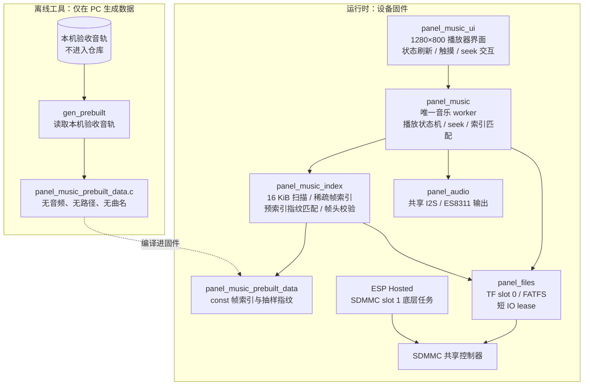

# 音乐播放器架构说明

日期：2026-10-30
分支：`music-player`，基于稳定版提交 `1dc3466`；回退基线见下
固件版本：`1.4.0-music-player`
回退基线：`05_版本发布/v1.3.0-fps-memory-kept`（未修改、未覆盖）

> 本文档描述当前实现与已核实的主机/板端证据，**不代替用户验收**。当前板上实际
> 镜像来自 `build-music-player-spin-off`，SHA-256
> `0DC6784D769380CBC53614B963A0C0A2ED2D0B0A0B1D7E7E67B66CFD49123544`；
> 烧录日志 `flash-20261030-005535.log` 记录三区校验通过。

## 1. 目标与边界

设备在 `music-player` 分支上改为**单一音乐播放器启动界面**。启动路径只创建新的
`panel_music_ui` 页面，不再进入锁屏、桌面、设置、天气等旧多功能 UI。旧 `panel_ui`
源码保留在仓库中，作为 `main` / 已归档固件的回退资料；它不在 `main` 的启动依赖中，
最终 ELF 内也检索不到 `ui_page_home_create` 等旧页面符号。

本阶段没有提交、推送。早期实板验证由 Codex 独立执行；当前板上固件状态、时间戳与
待确认项见验证记录。文档不把“心跳正常”或“已烧录”表述为用户验收完成。

## 2. 分层与调用方向

```text
main.c
  └─ panel_music_ui        # 新启动页、1s 状态刷新、可选唱片旋转、串口诊断
       └─ panel_music      # 单音频 worker、播放状态机、真实 seek、循环/随机/收藏
            ├─ panel_music_index   # MP3 帧扫描、时长、稀疏字节索引、离线预索引
            ├─ minimp3             # 真实 MP3 解码
            ├─ panel_audio         # 共享 I2S/ES8311 输出
            └─ panel_files         # TF 挂载、共享 SDMMC 与 IO 锁
       └─ panel_bsp        # 显示/触摸/背光/LVGL 适配器
```

调用只向下，UI 不直接操作 I2S、SDMMC 或寄存器；后端不反向 include UI。

### 2.1 当前播放器架构图



运行时只有**一个音乐 worker**；索引在当前播放命令内同步完成，不创建第二个
索引任务或第二个播放 FILE。离线生成工具不属于设备运行时，只在 PC 侧读取验收
音轨并输出 `const` 数据。

关键新增文件：

| 文件 | 作用 |
| --- | --- |
| `03_固件工程/components/panel_music_ui/src/panel_music_ui.c` | 1280×800 播放器界面、真实状态绑定、seek 交互、切歌动画 |
| `03_固件工程/components/panel_music_ui/src/panel_music_ui_diag.c` | 串口只读诊断与后端控制命令 |
| `03_固件工程/components/panel_music/src/panel_music_index.c` | MP3 帧扫描、VBR/时长/字节索引、真实帧头 |
| `03_固件工程/components/panel_music/src/panel_music_prebuilt_data.c` | 离线生成的四曲精简帧索引与抽样指纹；不含音频 |
| `03_固件工程/components/panel_music/src/panel_music.c` | 真实播放、暂停、预索引匹配/回退、seek、连续播放、随机/循环 |
| `03_固件工程/components/panel_music_ui/assets/` | 预烘焙 RGB565/565A8 背景、唱片、封面、曲目卡、A8 图标 |
| `03_固件工程/components/panel_music_ui/fonts/` | 六款 4bpp raw 子集字体 |
| `04_开发工具/播放器素材生成/generate_assets.py` | 素材与自制 SVG→A8 可复现生成脚本 |
| `04_开发工具/字体工具/generate_music_fonts.js` | Noto Sans SC 字体子集生成脚本 |

## 3. 启动与单一 LVGL 任务

`main.c` 只调用 `panel_services_init_music_only()`，不会走旧七页的
`panel_services_init()`。最小初始化只包含：

1. 设置默认亮度并打开背光；
2. `panel_files_init()` 挂载 TF（slot 0）；
3. `panel_audio_init()` 创建共享音频 worker；
4. `panel_music_init()` 创建唯一音乐 worker。

不启动 Wi-Fi/BLE、天气、时钟、外置字体、锁屏壁纸或文件浏览后台任务。
ESP-Hosted 的 transport 构造函数仍负责 SDMMC slot 1/共享控制器，TF 才能作为
slot 0 挂载；因此 **ESP Hosted 底层任务仍会启动**，共享 SDMMC 依赖未删除。
本文档不宣称网络栈已完全移除，也没有创建网络业务页面/业务任务。

随后调用：

```c
panel_music_ui_start();
panel_music_ui_start_console();
```

`panel_music_ui_start()` 在创建/加载屏幕前调用一次 `panel_bsp_lock(2000)`，完成后
`panel_bsp_unlock()`；页面构建过程不再嵌套获取锁。没有创建第二个 LVGL 任务。

## 4. 界面规格

画布固定宏：`SCR_W=1280`、`SCR_H=800`、`CX=640`。主要坐标如下：

| 元素 | 规格 |
| --- | --- |
| 背景 | 1280×800 RGB565 预烘焙，Flash 常量，8×8 Bayer 抖动；基色 `#101012` |
| 顶部 | 左右各 44×44 px 按钮；双行标题在 `CX` 居中 |
| 进度环 | 380×380，中心 `(CX,266)`；12 点起顺时针；白色旋钮；紫轨道/橙进度 |
| 黑胶唱片 | 344×344，与进度环同心；预烘焙；中心有 10 px 唱片孔 |
| 圆封面 | 180×180；当前诊断构建 `ENABLE_DISC_SPIN=0`，封面不旋转 |
| 左右曲目卡 | 160×160，x=96 / x=1024，卡片中心与唱片中心对齐 |
| 歌名 | y=484，32 px 粗体 |
| 歌手 | y=536，16 px 常规 |
| 时间 | y=576，显示真实 `当前 / 总时长` |
| 状态补充 | y=592，12 px；显示音源/输出格式或后端真实 detail |
| 播放按钮 | 76×76，中心 `(CX,648)` |
| 随机/上一首/下一首/循环 | 56×56 点击区，中心 y=648，与播放按钮同排 |
| 底栏 | y=736，带轻量底部 scrim；收藏、列表、音量、队列、下载 |

交互约束：

- 所有按钮点击区 ≥44×44 px；按下样式缩放 `241/256 = 94.1%`。
- 上一首/下一首切换使用 150 ms 滑出 + 150 ms 滑入，合计 300 ms。
- 圆封面仅由 `lv_image_set_rotation` 旋转；黑胶本身静止。
- 当前诊断构建关闭封面旋转：原 20 fps 旋转在实板播放时导致屏幕卡住；关闭后
  连续播放界面正常。是否恢复旋转需后续按实板数据决定，不把“已关闭”当作最终
  交互方案。
- `ENABLE_DISC_SPIN=0/1` 为编译期开关，不改变音频/seek 路径。
- 进度环支持 `LV_EVENT_PRESSED/VALUE_CHANGED/RELEASED`；拖动时只预览时间，
  松手后由后端执行真实 seek。
- 收藏默认实心红心（未收藏暗红、已收藏亮红）；随机默认橙色；循环开启橙色。
- 列表、队列、下载、更多、最小化尚未实现，统一弹出中文“尚未实现，当前不可用”
  提示，不伪装成已完成。
- 不使用定时器伪造播放进度：1 s timer 只读取后端状态刷新显示。

## 5. 真实音频与 seek

### 5.1 索引

`panel_mp3_index_build_leased()` 只扫描 MPEG Layer III 帧头，不依赖 Xing/VBRI：

- 从 ID3v2 结束位置按 16 KiB 块读取；每块读取单独获取/释放 TF I/O lease，
  不整曲持锁；每块前检查取消；
- 从 ID3v2 结束位置扫描，识别 MPEG1/2/2.5、Layer III、采样率、声道、帧长；
- 以物理帧累计采样数，得到 `duration_ms`；首 Info/Xing 帧也纳入时间轴，
  与 minimp3 物理帧口径一致；
- 每 8 帧记录一次 `{字节偏移, 帧序号, 时间, 采样偏移, 帧头}`；索引满时抽稀并将
  步距翻倍（上限 64 帧），长曲仍覆盖；帧头用于 seek 起点本地校验；
- 扫描缓冲明确使用 PSRAM 能力分配；失败返回错误，不占用内部 DMA RAM；
- 时长来自实际帧采样，不是定时器，也不是恒定码率估算；VBR 同样成立。

成功扫描后在同一 FILE 上以短 lease `fseek` 回 ID3 结束位置，失败则报
“索引后复位失败”，不进入播放。

### 5.2 离线预索引与快速匹配

- 生成器只读本机验收音轨，输出 `const` 帧索引、帧头和采样指纹；仓库不包含音频。
- 每首预索引保存与完整扫描逐 entry 一致的 `{字节偏移, 帧序号, 时间, 采样偏移,
  帧头}`，以及 16 个 64 B 采样指纹；首指纹覆盖文件头/ID3，末指纹位于
  `file_size-64`，不是 EOF 空采样。
- 启动时先核对文件长度、ID3 标签长度和这些升序采样；全部匹配才加载预索引，
  然后把同一 FILE 定位回 `data_start`。不匹配回退单 FILE、16 KiB 顺序完整扫描。
- 指纹是抽样校验，**不是全文件哈希**：未采样区域被修改可能无法发现；文件大小、
  ID3 长度或采样区域变化才会触发回退。无法确定时一律回退完整扫描。
- 预索引探测按短 lease 分段；每段前检查 generation/stop。TF 读失败直接报错，
  不把 I/O 错误当作“不匹配”继续盲扫。
- 索引完成发布前在同一状态锁内复核播放 generation 和 stop；旧曲扫描不能把
  READY/duration 发布到新曲。停止/切歌/错误路径统一清理 pending 和索引标志。

### 5.3 Seek 与音质恢复

1. 按请求代数绑定目标时间、序号、pending；旧代数完成时不能清掉新请求；
2. 目标时间二分查稀疏索引，取时间轴条目及额外 2 个索引项做 reservoir 预热；
3. `fseek` 到预热起点；在 TF lease 内完成，失败不报告成功；
4. 在预热起点读取实际帧头，与索引中 **warmup 条目**的帧头比较；不一致时
   清除该代 seek pending，继续当前播放，不假报跳转成功；
5. 解码预热帧但不计入时间轴；到时间轴条目后开始按**物理帧**推进；
6. 跨目标帧按目标样本裁剪；使用不可变 `pcm_base` 解码/free，每帧单独
   `pcm_view` 做裁剪与重采样，绝不移动分配指针；
7. 关闭并重开音频流以丢弃旧 PCM/DMA 队列，重置重采样器相位；状态位置只在
   目标帧真正进入输出路径后更新为 `跳转中完成`；
8. 暂停时只消费最新请求并静音等待；恢复后才输出最新目标，不在暂停中空转。

I2S 关闭路径能停止输出并关闭 codec，但“DMA 已播样本完全清零”尚不能由主机
证明，保留实板听感/示波器验证项。

### 5.4 状态与生命周期

后端只有一个 worker 和深度 4 的命令队列。状态为：
`IDLE → LOADING → PLAYING ⇄ PAUSED → STOPPING → STOPPED/ERROR`。

- 自然播完：若随机开启，选真实随机曲目；否则顺序下一首；末尾且循环开启则回首曲，
  否则停在 `STOPPED`。连续播放不靠 UI 定时器。
- 手动上一首/下一首作用于真实曲目表；播放中/暂停中切歌会重新打开真实文件。
- 暂停时静音 codec，恢复时恢复原音量，位置不推进；暂停等待固定 20 ms 延时，
  不因 pending 变成忙循环。
- 随机/循环/收藏为当前运行期状态；没有写 NVS，因此重启恢复默认值。
- 音量实时作用于 ES8311；暂停期间改音量不会意外解除静音。

### 5.5 资源

- 单 worker 栈 12 KiB；目标编译的 `worker` 静态栈帧 1648 B。
- minimp3 scratch 约 16.2 KiB、索引约 40 KiB、扫描缓冲 16 KiB 均在 PSRAM，
  复用不逐曲增长；预索引 const 数据约占 Flash 262 KiB。
- 图片全部 `const` 预烘焙数据，驻留 Flash；运行时不做模糊、缩放、实时阴影。
- 字体为 Noto Sans SC 子集 4bpp raw，不使用 LVGL 内建 CJK 字体。
- 图标为自制 SVG，经 4× 超采样生成 A8，LVGL 仅做 recolor。

## 6. 素材与字体

- 背景：`music_bg.c/bin`，1280×800 RGB565，抖动后约 2.0 MiB。
- 唱片：`music_vinyl.c/bin`，344×344 RGB565A8，约 355 KiB。
- 封面：四首各 180×180 RGB565A8；曲目卡四首各 160×160 RGB565A8。
- 图标：15 个图标 × 24/32 px A8。
- 字体：
  - 常规 12/13/14/16：`music_font_12/13/14/16`
  - 粗体 15/32：`music_font_15_bold/32_bold`
  - 全部 `bitmap_format=0`、4 bpp、未压缩；ASCII 全量 + 界面/后端提示所需 177 个
    非 ASCII 字形。
- 字体来源：项目内 `NotoSansSC-Regular.otf` 与同一版本 Noto Sans SC Bold 2.002；
  版权元数据为 `© 2014-2020 Adobe (http://www.adobe.com/).`，SIL OFL 1.1。
  名称表核对、来源与可复现步骤见
  `03_固件工程/components/panel_music_ui/fonts/FONT_NOTICE.md` 和同目录
  `OFL.txt`；粗体由 `NOTO_SANS_SC_BOLD` 指定，不提交系统字体文件。
- 曲目封面是自制的抽象图，不使用官方专辑封面，避免版权与素材依赖。

## 7. 真实曲目

界面元数据来自 `panel_music_tracks.c` 的受控音轨映射；此前实板日志已确认四首均能
打开并解码。索引扫描得到的真实时长：

| 编号 | 扫描时长 |
| --- | --- |
| track 0 | 6:01.090 |
| track 1 | 3:50.530 |
| track 2 | 4:29.244 |
| track 3 | 3:20.124 |

公开文档不记录歌曲名、歌手名或本机绝对路径。无文件模拟截图只能用于 UI 回归，
不作为实板内容替代。

## 8. 构建与板端镜像

当前板上实际镜像来自 `build-music-player-spin-off`：

- SHA-256：`0DC6784D769380CBC53614B963A0C0A2ED2D0B0A0B1D7E7E67B66CFD49123544`
- 烧录日志：`flash-20261030-005535.log`，三区校验通过
- 该镜像关闭封面旋转；track 0 打开时间戳 7391 ms、预索引命中 7451 ms、
  音频流打开 7543 ms，约 152 ms；**不是扬声器首声实测**
- 连续播放 17 秒 UI 心跳正常；用户确认同 spin-off 版本此前不卡。
- 用户刚刚确认新版开播、四首曲目切换、拖动、声音、屏幕“正常”；这是有限人工
  验收，不证明长期稳定性、反复切歌、边界 seek、异常卡/坏文件等条件。


当前源码另有 `build-music-player-sync-prebuilt` 候选（SHA-256
`87D1D1ADEB8413F27DA70C6B4A1A8ECB4648D820FC424FA034EFC3E15031BCDD`），
属于单任务 + 16 KiB 同步预索引候选，**不是当前板上镜像，未做实板验收**。

历史镜像 `148C9F...` 为早期构建；不作为当前板端状态。64 KiB 同步读取与并行双文件
候选在实板出现 `0x107` SDMMC 超时，已停止该路线，只保留为历史失败结果。

## 9. 未完成/限制

- 收藏、随机、循环、音量目前是运行期状态，未持久化到 NVS。
- 列表/歌单、队列、下载、更多/最小化仍是明确提示的未实现功能。
- 当前诊断构建关闭封面旋转；原 20 fps 旋转导致播放时屏幕卡住，恢复策略待定。
- 预索引只做 16 处抽样指纹，**不能检测未采样区域修改**；大小/ID3/采样不符或
  无法确定时回退完整 16 KiB 扫描。回退整扫约 13.5 秒，不宣称快速启动。
- TF 读失败必须报错，不把 I/O 错误当作普通不匹配继续盲扫；seek 帧头校验失败
  清除 pending 并继续当前播放，不假报成功。
- ESP Hosted 底层任务因共享 SDMMC 仍启动，未宣称网络栈完全移除。
- 已获得有限人工验收：开播、四曲切换、拖动、声音、屏幕正常；长期稳定性、反复
  切歌、边界 seek、异常卡/坏文件等未验证。主机测试与板端心跳不等于全面验收。
- `esp_codec_dev_close()`/I2S disable 的“DMA 已播样本清零”未由主机证明，
  保留实板听感验证。
- 主机截图不是面板照片；实际颜色、触摸坐标、音频输出需实板确认。
